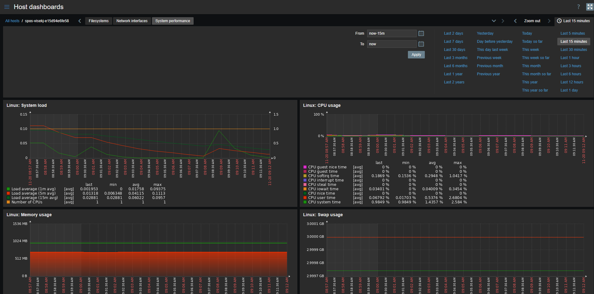
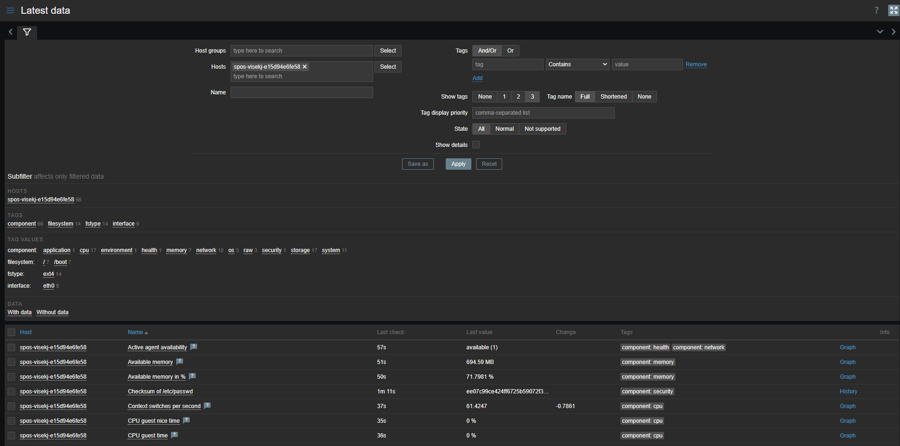

# OSY: automatická registrace Debianu 13 do Zabbixu 8.0

Autor: kn3dl7

Projekt vytvoří přes Vagrant virtuální stroj s Debianem 13 (box `bento/debian-13`, VirtualBox), nainstaluje do něj **Zabbix Agent 2 verze 8.0 LTS** z oficiálního repozitáře Zabbixu a nastaví ho tak, aby se sám zaregistroval na server `enceladus.pfsense.cz`. Pro auto-registraci agent posílá `HostMetadata=SPOS`.

## Postup práce

1. Naklonoval jsem svůj repozitář ze šablony a odstranil nepoužité soubory.
2. Vytvořil jsem `Vagrantfile` s boxem `bento/debian-13` a třemi shell provisionery.
3. Napsal jsem skript pro instalaci nástrojů a skript, který přidá repozitář Zabbix 8.0 a nainstaluje `zabbix-agent2`.
4. Napsal jsem konfigurační skript: vygeneruje jedinečné jméno hosta, nastaví `Server`, `ServerActive`, `Hostname` a `HostMetadata` a restartuje službu.
5. Spustil jsem `vagrant up`, ověřil agenta ve VM a v Zabbixu zkontroloval registraci hosta a přijatá data.
6. Pořídil jsem snímky obrazovky do `Images/`.
## Spuštění

```sh
vagrant validate
vagrant up
```

Vagrant po vytvoření VM sám spustí tři skripty (`install-tools.sh`, `install-zabbix8-agent2.sh`, `configure-zabbix8-agent2.sh`). Po změně skriptů stačí `vagrant provision`.

## Jak řešení funguje

- **Jméno hosta** má tvar `spos-visekj-xxxxxxxxxxxx` (12 náhodných hex znaků). Vygeneruje se jednou a uloží do `/var/lib/zabbix/spos-hostname` ve VM, takže přežije restart i opakovaný provisioning. Nová VM po `vagrant destroy` dostane nové jméno. Můj host se jmenuje ` spos-visekj-e15d94e6fe58`.
- **Agent 2 8.0** se instaluje z repozitáře Zabbix 8.0 (balíček `zabbix-release` pro Debian 13), ne z výchozího repozitáře Debianu. Pokud už je nainstalovaný agent verze 8, instalace se přeskočí. Starší agent by se před instalací odstranil. Na konci skript ověří, že verze začíná na 8.
- **Konfigurace** (`/etc/zabbix/zabbix_agent2.conf`): skript nejdřív smaže případné staré hodnoty `Hostname`, `Server`, `ServerActive`, `HostMetadata` a pak připíše vlastní. Při opakovaném provisioningu tak nevznikají duplicity. Originál se zálohuje jako `zabbix_agent2.conf.orig`.
- Služba `zabbix-agent2` se povolí (`enable`) a restartuje.

## Ověření

```sh
vagrant ssh
cat /var/lib/zabbix/spos-hostname
dpkg -l zabbix-agent2
zabbix_agent2 -V
systemctl status zabbix-agent2
sudo grep -E '^(Hostname|Server|ServerActive|HostMetadata)=' /etc/zabbix/zabbix_agent2.conf
getent hosts enceladus.pfsense.cz
nc -z -w 5 enceladus.pfsense.cz 10051
ss -tlnp | grep 10050
sudo journalctl -u zabbix-agent2 -n 20 --no-pager
```

Host je v Zabbixu zaregistrovaný automaticky:



Latest data téhož hosta dokládají příjem naměřených hodnot:



## Soubory

- `Vagrantfile`: box Debian 13, VM `spos-debian-zabbix` (1 GB RAM, 1 CPU) a automatický provisioning.
- `install-tools.sh`: instalace pomocných nástrojů (`fastfetch`, `joe`, `vim`, `htop`, `btop`, `mc`, `nmap`, `git`, `curl`, `wget`, `netcat`).
- `install-zabbix8-agent2.sh`: přidání repozitáře Zabbix 8.0, instalace `zabbix-agent2`, kontrola verze.
- `configure-zabbix8-agent2.sh`: stálé jméno hosta, konfigurace agenta, spuštění služby.
- `Images/`: snímky hosta z webového rozhraní Zabbixu.

## Zdroje

- [Zabbix 8.0: instalace z balíčků](https://www.zabbix.com/documentation/8.0/en/manual/installation/install/packages)
- [Zabbix 8.0: parametry agenta 2](https://www.zabbix.com/documentation/8.0/en/manual/concepts/agent2/agent2_params)
- [Zabbix 8.0: automatická registrace](https://www.zabbix.com/documentation/8.0/en/manual/discovery/auto_registration)